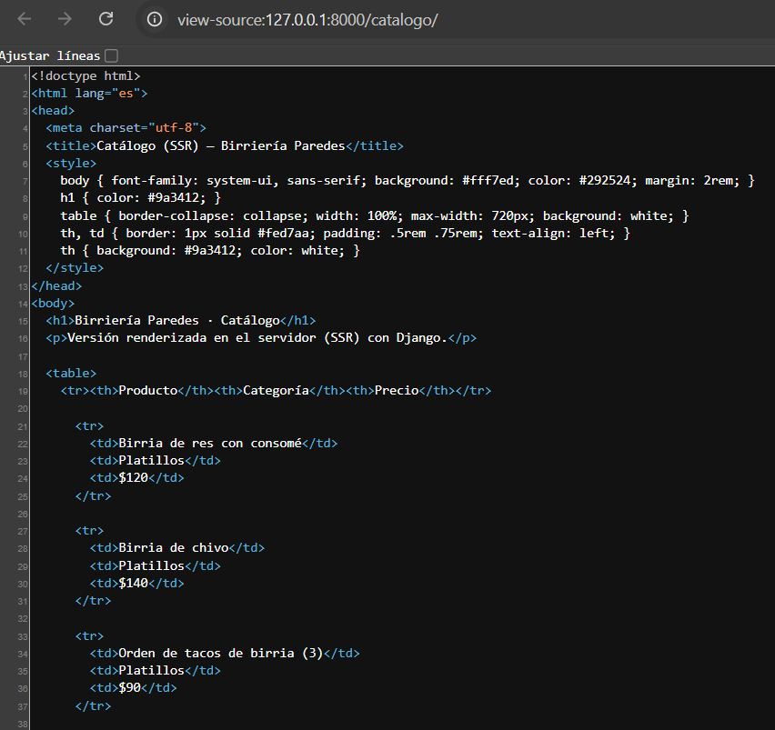
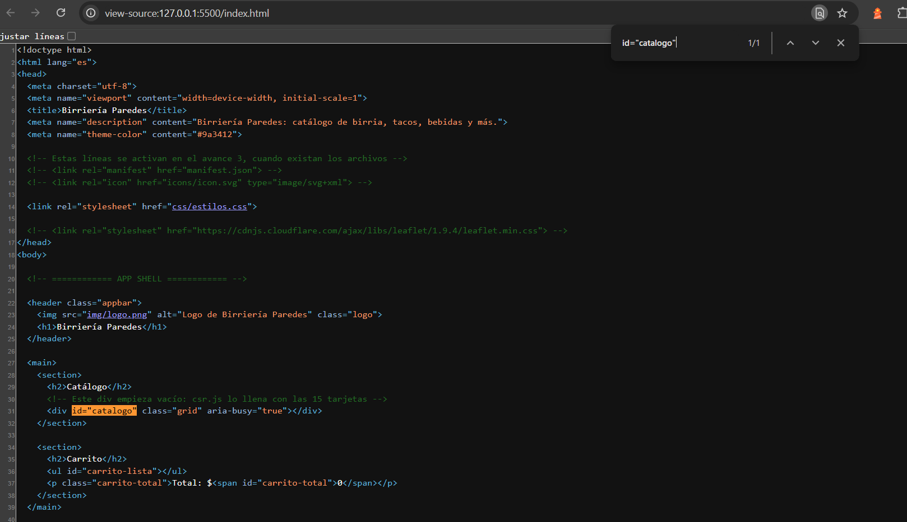
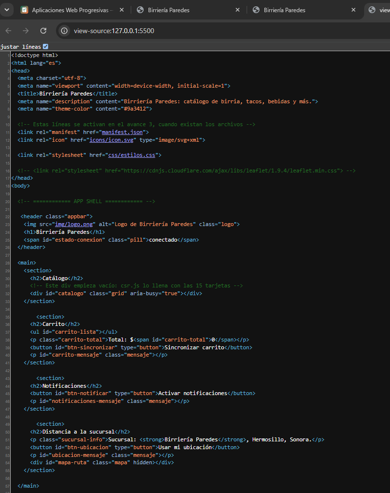
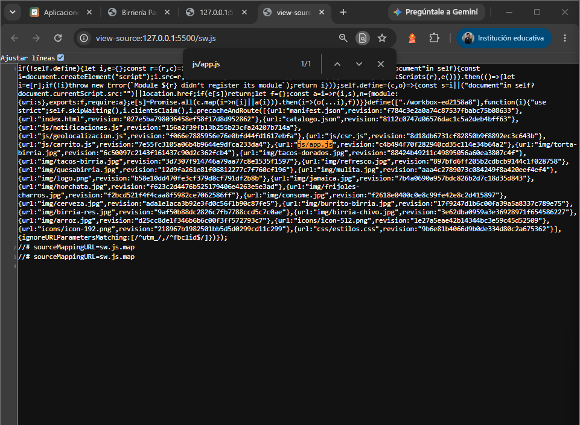

# Birriería Paredes — PWA

## Identificación
- **Alumno:** PAREDES MIRANDA BRYAN HUMBERTO
- **Grupo:** ING10-1
- **Negocio:** Birriería Paredes
- **Giro:** Birriería
- **URL del repositorio:** https://github.com/paredesmirandabryan/birreria-paredes-pwa_paredes-miranda-bryan-humberto
- **URL de GitHub Pages:** https://paredesmirandabryan.github.io/birreria-paredes-pwa_paredes-miranda-bryan-humberto/

## Historial de avances
| Avance | Hash del commit entregado | Fecha |
|---|---|---|
| 1 | 5a552df3762224aeac7576a7b0f031821c991c9d | 11/10/2026 |
| 2 | 74b93009693f3b4803bc8674747b7096e47904b3 | 18/10/2026 |
| 3 | 199179387da6721f731d22f38d6381c7577e3264 | 25/10/2026 |
| 4 | (se escribe en el reporte PDF) | 01/11/2026 |

## Comparación SSR vs CSR

### SSR (Django): los productos llegan escritos en el HTML

### CSR (JavaScript): el div del catálogo llega vacío

## Funciones PWA (avance 3)

### index.html: manifest y registro del Service Worker activos

### sw.js: Workbox precachea el catálogo y las fotos

## Guía de instalación y uso

### Cómo abrirla
1. Entra a https://paredesmirandabryan.github.io/birreria-paredes-pwa_paredes-miranda-bryan-humberto/ desde Chrome (o Safari en iPhone).
2. Espera a que cargue el catálogo con los 15 productos de la birriería.

### Cómo instalarla
- **Computadora (Chrome):** haz clic en el ícono de instalar (⊕) a la derecha de la barra de direcciones y confirma.
- **Android (Chrome):** toca el menú ⋮ y elige "Instalar aplicación".
- **iPhone (Safari):** toca Compartir y elige "Agregar a pantalla de inicio".
- Ábrela desde el ícono con el logo: debe verse sin la barra del navegador.

### Cómo usarla
1. Filtra el menú por categoría: Platillos, Extras o Bebidas.
2. Pulsa "Agregar" en un producto: aparece en "Tu pedido" a la derecha.
3. Cambia las cantidades con + y − o quita el producto.
4. Pulsa "Activar notificaciones" para recibir avisos del pedido.
5. Pulsa "Usar mi ubicación" para ver la distancia hasta la sucursal.

### Sin conexión
Después de abrirla una vez con internet, la app guarda el catálogo y las fotos. Si pierdes la conexión sigue funcionando y el encabezado dice "sin conexión".

