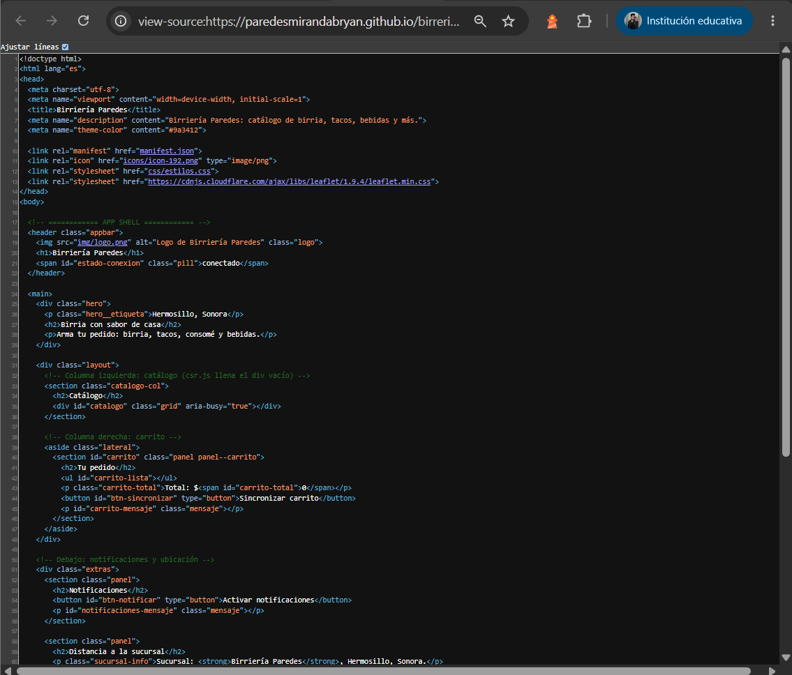
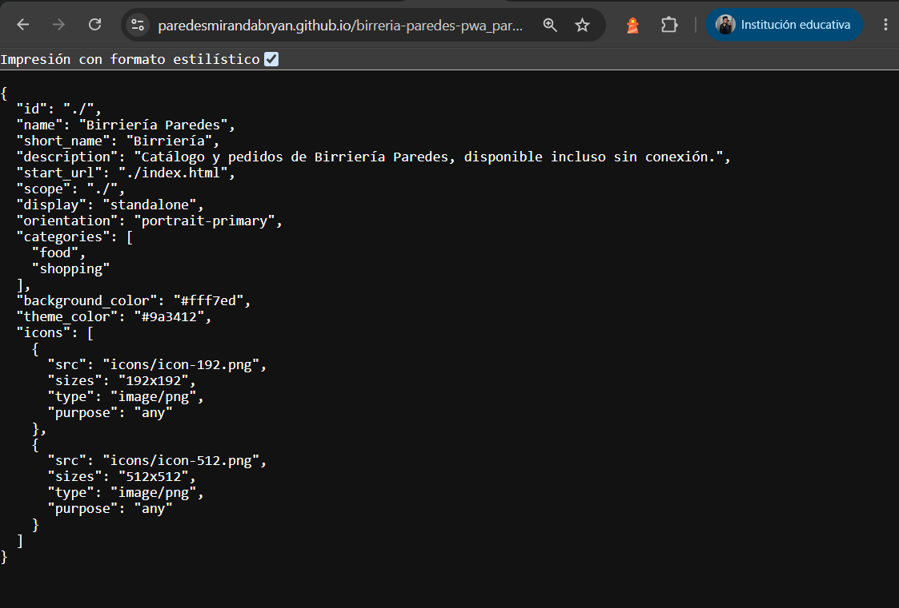
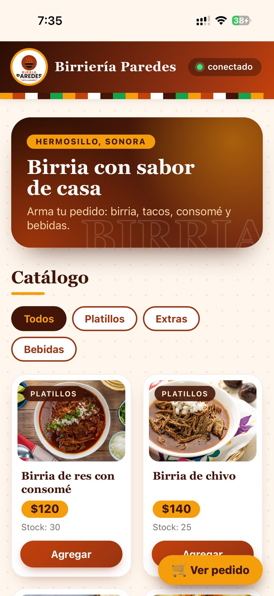

# Birriería Paredes — PWA de ventas

| Dato | Valor |
|---|---|
| **Alumno** | PAREDES MIRANDA BRYAN HUMBERTO |
| **Grupo** | ING10-1 |
| **Negocio · giro** | Birriería Paredes · Birriería |
| **URL del repositorio** | https://github.com/paredesmirandabryan/birreria-paredes-pwa_paredes-miranda-bryan-humberto |
| **URL de GitHub Pages** | https://paredesmirandabryan.github.io/birreria-paredes-pwa_paredes-miranda-bryan-humberto/ |

## Historial de avances

| Avance | Hash del commit entregado | Fecha |
|---|---|---|
| 1 | 5a552df3762224aeac7576a7b0f031821c991c9d | 11/10/2026 |
| 2 | 74b93009693f3b4803bc8674747b7096e47904b3 | 18/10/2026 |
| 3 | 199179387da6721f731d22f38d6381c7577e3264 | 25/10/2026 |
| 4 | (se escribe en el reporte PDF) | 01/11/2026 |

## Comparación SSR vs CSR

### SSR (Django): los productos llegan escritos en el HTML

### CSR (JavaScript): el div del catálogo llega vacío

## Funciones PWA (avance 3)

### index.html: manifest y registro del Service Worker activos

### sw.js: Workbox precachea el catálogo y las fotos

## Versión publicada (avance 4)

### index.html en GitHub Pages

### manifest.json en GitHub Pages

### Mi app instalada en el celular

## Guía de instalación y uso

Esta guía explica cómo abrir, instalar y usar la app de Birriería Paredes.

### 1. Abrirla
1. Abre Chrome (o Safari si tienes iPhone).
2. Escribe esta dirección: https://paredesmirandabryan.github.io/birreria-paredes-pwa_paredes-miranda-bryan-humberto/
3. Espera unos segundos a que aparezca el menú con los 15 productos y sus fotos.

### 2. Instalarla
- **En Android (Chrome):** toca los tres puntos (⋮) de arriba a la derecha y elige "Instalar aplicación".
- **En iPhone (Safari):** toca el botón Compartir y elige "Agregar a inicio".
- **En computadora (Chrome):** haz clic en el ícono de instalar que aparece a la derecha de la barra de direcciones.
- Al terminar, aparece el ícono con el logo de la birriería en tu pantalla. Ábrela desde ahí: debe verse a pantalla completa, sin la barra del navegador.

### 3. Usarla
1. Con los botones de arriba del menú (Todos, Platillos, Extras, Bebidas) filtras los productos por categoría.
2. Pulsa "Agregar" en el producto que quieras: aparece en "Tu pedido".
3. En tu pedido puedes subir o bajar la cantidad con los botones + y −, o quitar el producto.
4. Pulsa "Sincronizar carrito" para enviar tu pedido (es una simulación).
5. Pulsa "Activar notificaciones" y acepta el permiso para recibir avisos de tu pedido.
6. Pulsa "Usar mi ubicación" para ver en el mapa la distancia hasta la sucursal.
7. En el celular, el botón amarillo "Ver pedido" te lleva directo al carrito.

### 4. Usarla sin internet
La primera vez que la abres con internet, la app guarda el menú y las fotos en tu dispositivo. Después, si te quedas sin conexión, sigue funcionando y el encabezado cambia a "sin conexión". Tu pedido se conserva y se puede enviar cuando vuelva el internet.

### 5. Probarla en tu computadora (para desarrolladores)
Abre la carpeta del proyecto en VS Code, da clic derecho sobre `index.html` y elige "Open with Live Server".