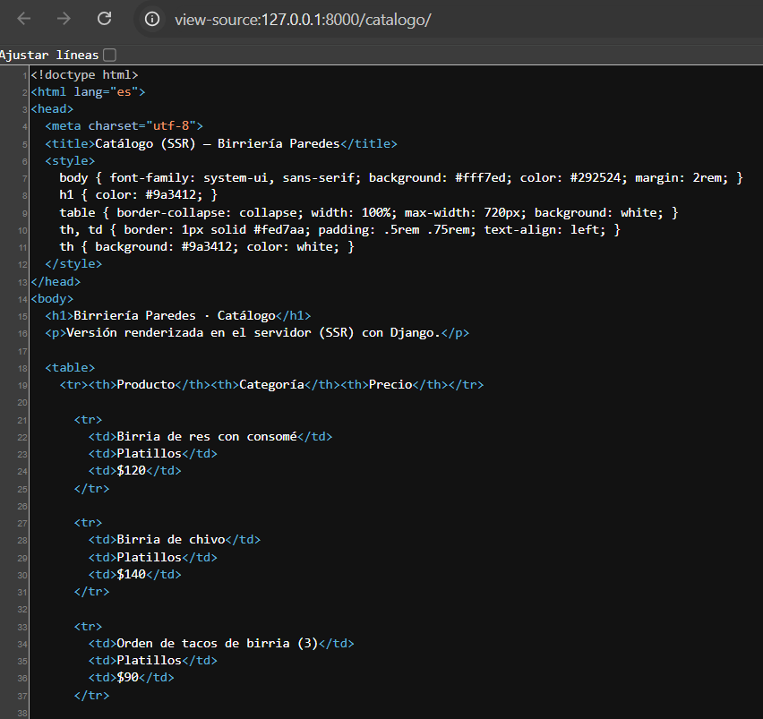
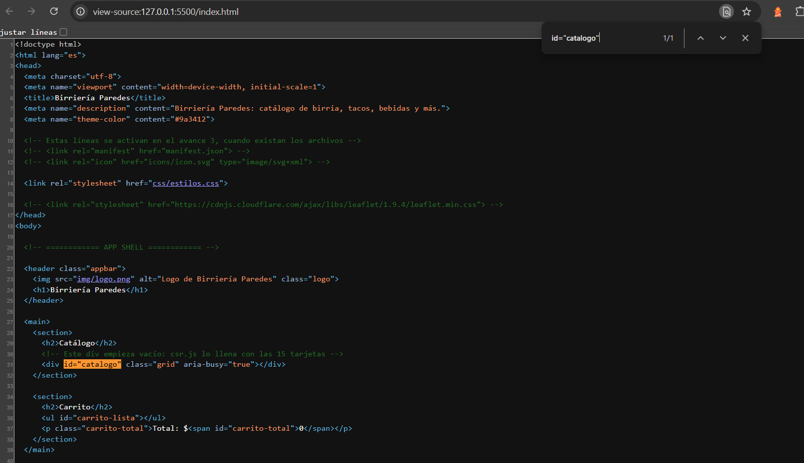
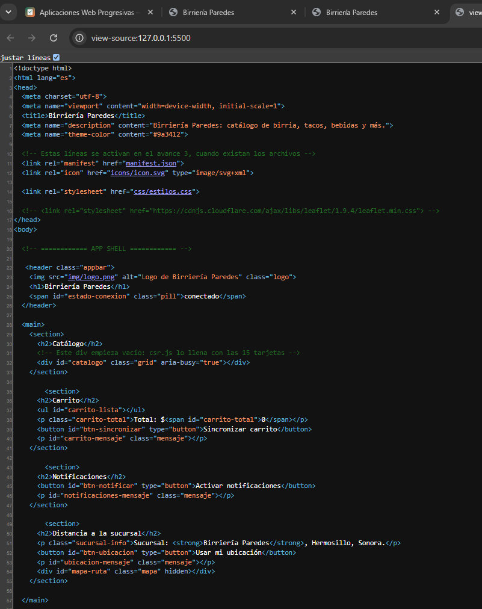
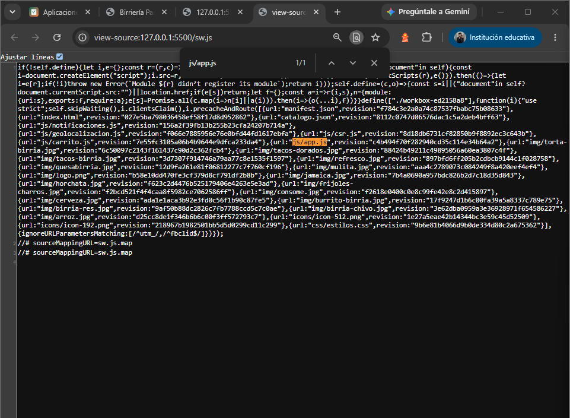

# Birriería Paredes — PWA

## Identificación
- **Alumno:** PAREDES MIRANDA BRYAN HUMBERTO
- **Grupo:** ING10-1
- **Negocio:** Birriería Paredes
- **Giro:** Birriería
- **URL del repositorio:** https://github.com/paredesmirandabryan/birreria-paredes-pwa_paredes-miranda-bryan-humberto
- **URL de GitHub Pages:** https://paredesmirandabryan.github.io/birreria-paredes-pwa_paredes-miranda-bryan-humberto/

## Historial de avances
| Avance | Hash del commit entregado | Fecha |
|---|---|---|
| 1 | 5a552df3762224aeac7576a7b0f031821c991c9d | 11/10/2026 |
| 2 | 74b93009693f3b4803bc8674747b7096e47904b3 | 18/10/2026 |
| 3 | 17a5e8a96370909515f25ac980ac0bb81a65f37d | 10/25/2026 |        
| 4 | | |

## Comparación SSR vs CSR

### SSR (Django): los productos llegan escritos en el HTML

### CSR (JavaScript): el div del catálogo llega vacío

## Funciones PWA (avance 3)

### index.html: manifest y registro del Service Worker activos

### sw.js: Workbox precachea el catálogo y las fotos

